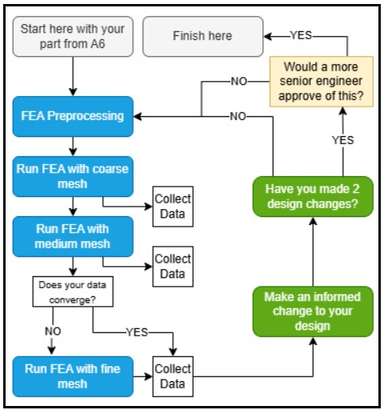
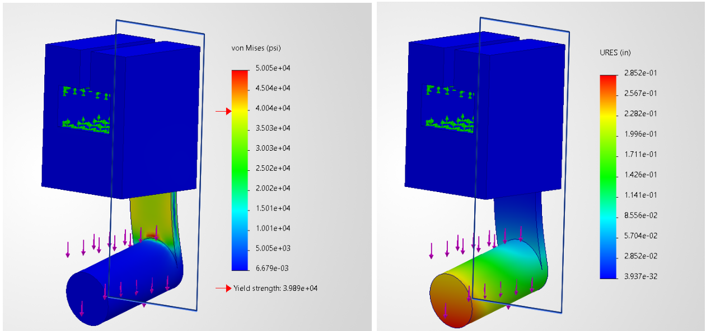
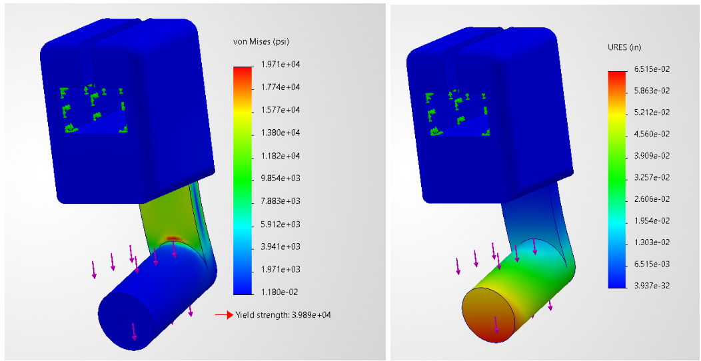
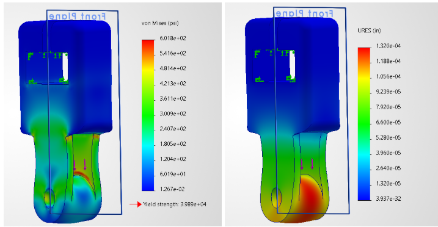
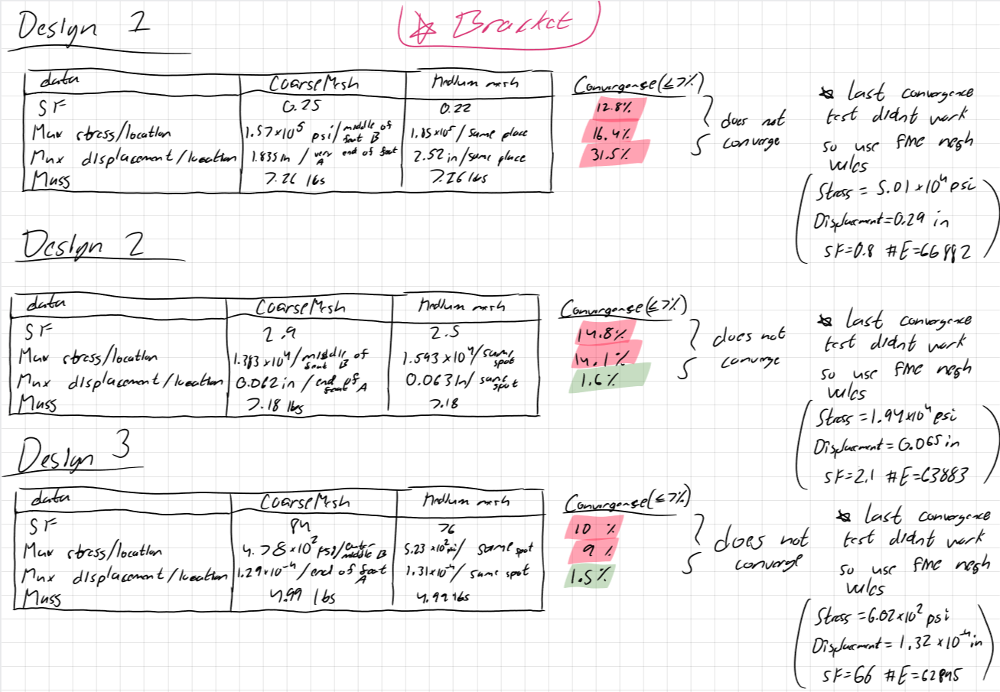
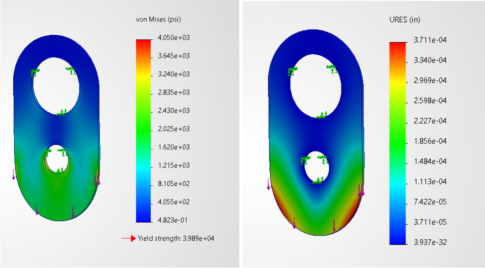
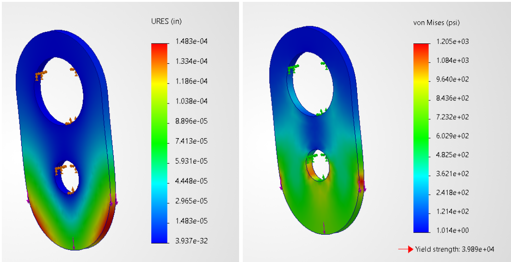
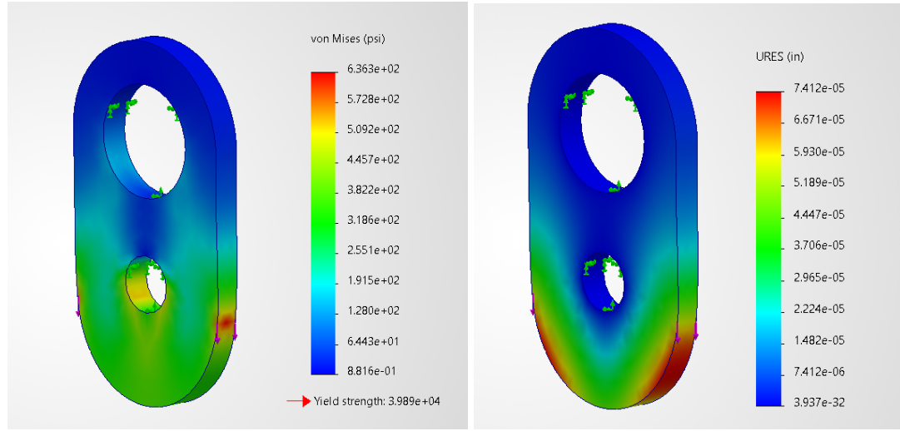
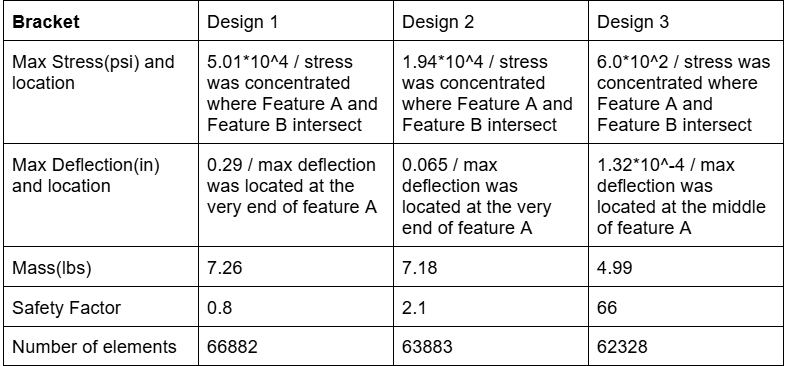
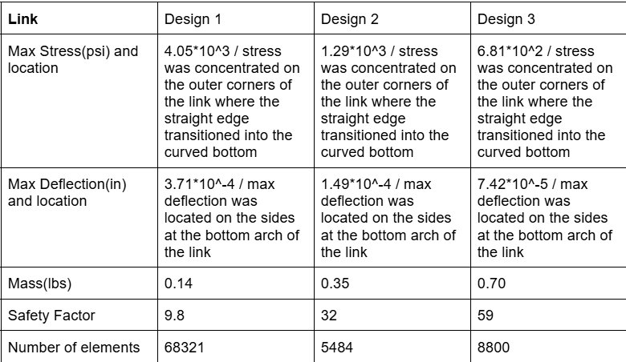

# A7 – Bracket FEA

## Objective
For this assignment I was tasked to complete a finite-element-analysis(FEA) on my bracket and link from A06. I had to use the results from the FEA to make different design changes with the intent to make a lightweight, high strength, and high stiffness bracket and link. 

## Analyze

Before I ever started to preform a FEA on any part, I first needed to understand what kind of workflow I would need. From my class lecture I knew there was an "inner loop" to preform FEA under a course and medium mesh. If those results didn't converge within 7% of each other I was to use a fine mesh and take those values down. Once that loop was complete I had an "outer loop" which consisted of making design changes based on my results and repeating the inner loop. I had to repeat this outer loop a minimum of 3 times. From my assignment I found a flow chart of the process seen below in figure 1. This is the chart I refered to throughout the process of this assignment. 

(Figure 1)

## Decide
### Bracket FEA / Design changes

(Figure 2)

(Figure 3)

(Figure 4)

(Figure 5)

### Link FEA / Design changes

(Figure 6)

(Figure 7)

(Figure 8)

(Figure 9)

## Communicate
### Final Bracket Results

### Final Link Results

### Reflection

### Download Final Designs
[error](bracket_final.SLDPRT)
[error](link_final.SLDPRT)
