# A8 – Gears

## Objective
For this assignment we were tasked to design a gearbox with given parameters. We had to use a pinion and gear with a ratio of 24:9, the output gear speed and torque are to be 1100RPM and 1.25in-lbf respectively, and the input shaft and output shaft diameters are to be 0.125in and 0.250in respectively with a length of 1in. The gearbox was to be able to be assembled and disassembled. 

## Analyze
To start this assignment I first needed to determine if the given diameters for the shafts were sufficient under the parameters. I strated by writing down all of my given values, the different assumptions I needed to make, and different important information that was notable.
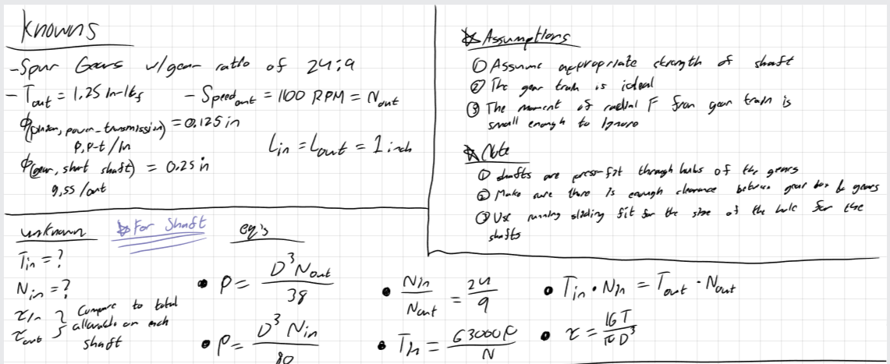
As seen in the lower half of the above picture, before I started to solve for the shafts I first wrote down each unknown value that I needed to solve for. I also took note of every important equation that I COULD use while solving for my unknowns. 
## Decide
### Math for Shafts and Bearings
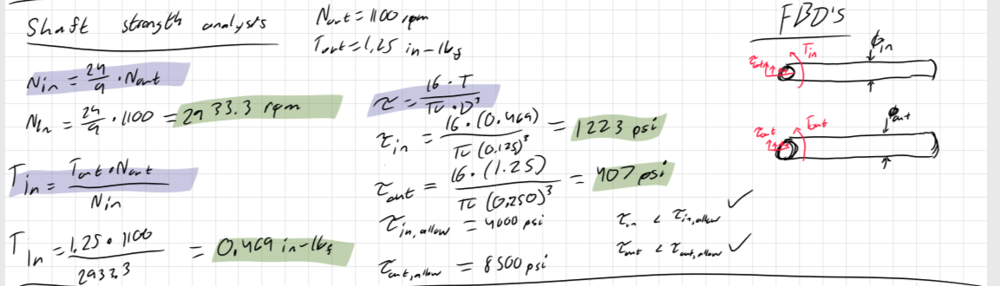

After analyzing important equations and unknown variables, I started to do the math which ended up being very "plug and play". I first found the input speed, then used that value to find the input torque, and I finally used the calculated input torque to find the input shear stress. I used the values I was given at the beginning to determine my output shear stress. After finding these values, I compared them to the maximum allowable stress in both shaft types and the test passed with flying colors. This led me to the conclusion that the shaft diameters I was given were very suitable.

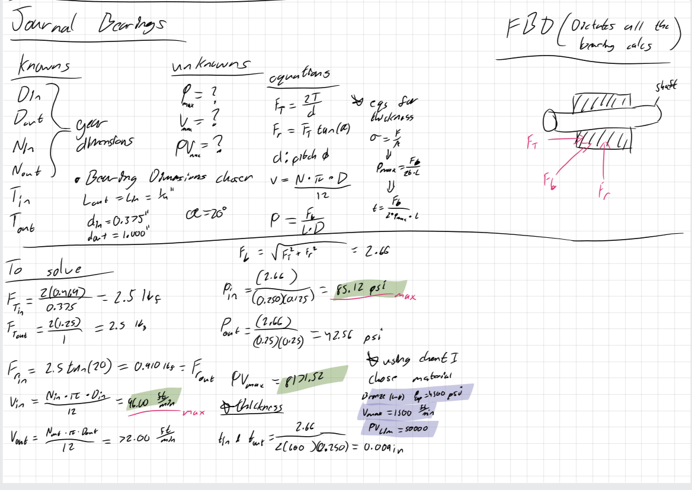
Once I found my shafts to be suitable I then needed to move on and design my journal bearings. This entailed choosing appropriate dimensions for the bearing, determining the max pressure, max velocity, max PV limit, and using these factors to determine what material I wanted to use. After choosing the material, I needed to use its max pressure to solve for thickness of the bearing. The way I interpreted this part of the assignment was that this found thickness was like a minimum thickness for the bearing, so when I choose a bearing from a supplier I know what my low-point is. I chose to use a quarter inch for my bearing length because that seemed to be the most rounded value that would successfully sit on my 1in shaft length along with the gear.

Taking all of this into account, I began writing out my unknowns, different equations I needed to utilize, and analyzing a free body diagram. After finding my max P, V and PV limit, I used a chart and cross referenced the supply site McMaster-Carr to chose bronze as the material for my bearings. I then used the default max pressure for bronze to determine my bearings minimum thickness. After solving for thickness and determining my material, I used McMaster-Carr to find the following bearings:

Pinion Bearing: https://www.mcmaster.com/9368T96/

Gear Bearing: https://www.mcmaster.com/9368T11/

### Concept for Gear Housing Unit
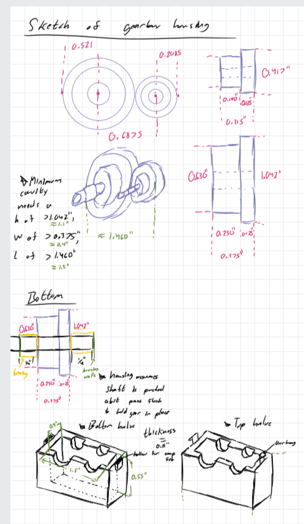

After determining what bearings I was using and that my shafts were a suitable size, I also needed to make a rough sketch for my gearbox housing. Seeing as this assignment required that the final design be able to disassemble, I had to make the housing in two parts, and determine how the two halves would fit together. The first half of the image above was me analyzing the different important dimensions of the gears, so that I could determine the minimum size of my housing cavity. The gear dimensions were given to me in the assignment on the McMaster-Carr website: 

Pinion: https://www.mcmaster.com/7880K19/

Gear: https://www.mcmaster.com/7880k24/

I decided to utilize two bearings on either side of the gears, so each gear wasn't prohibited by the housing. After determining all my dimensions I decided on the final rough sketch at the bottom of the page. I made sure to note that I wanted the thickness of the box to be about 0.15in on each side, and that I was using a snap fit mechanic to hold the top and bottom halves together.

## Communicate
### Imported CAD files from Mcmaster
The next 4 images are just isometric images for each CAD file I got off of McMastery-Carr. These are the same ones that I found earlier in the assignment and are the only ones I use in the design of the gearbox housing.

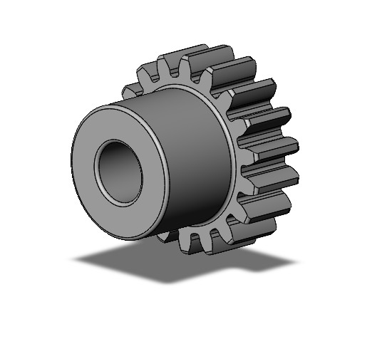

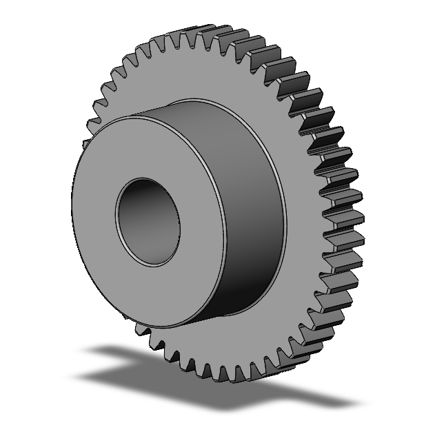

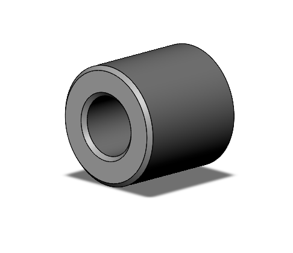

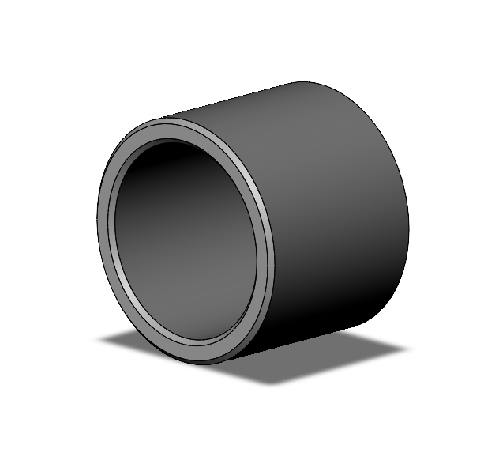
### Designed parts in CAD
#### Shafts
Before I 3D modeled my housing unit, I first went ahead and designed each shaft because they are short and simple. Both were made the exact same way, where I sketched the diameters of the shafts, the input and output at 0.125in and 0.250in respectively, and then extruded them out by an inch. These can be seen in isometric view in the next two images below.

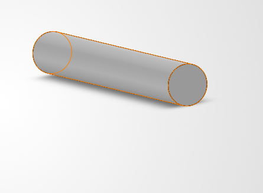

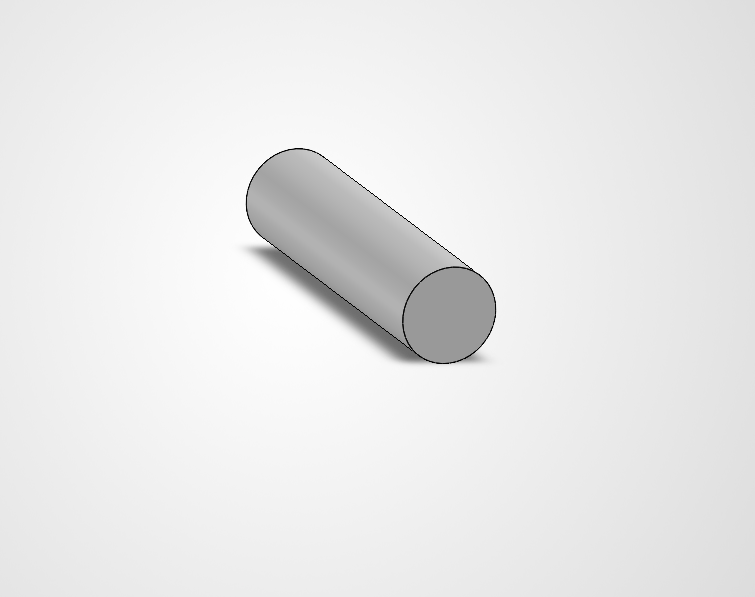
#### Gear Housing 
After I had imported each CAD file and designed both shafts, it was finally time to begin designing the gearbox housing starting with the bottom half. 

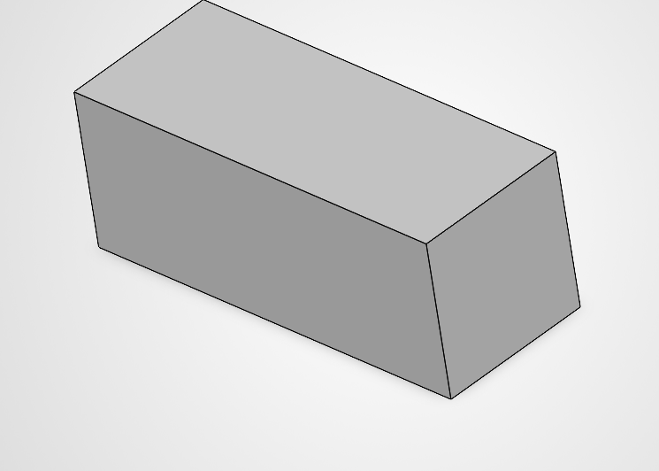

I Started by extruding a big box with the dimensions of 0.30in plus the minimum dimensions of the cavity needed. I did this so I could obtain the desired thickness that I listed in my concept sketch of 0.15in on all sides.  

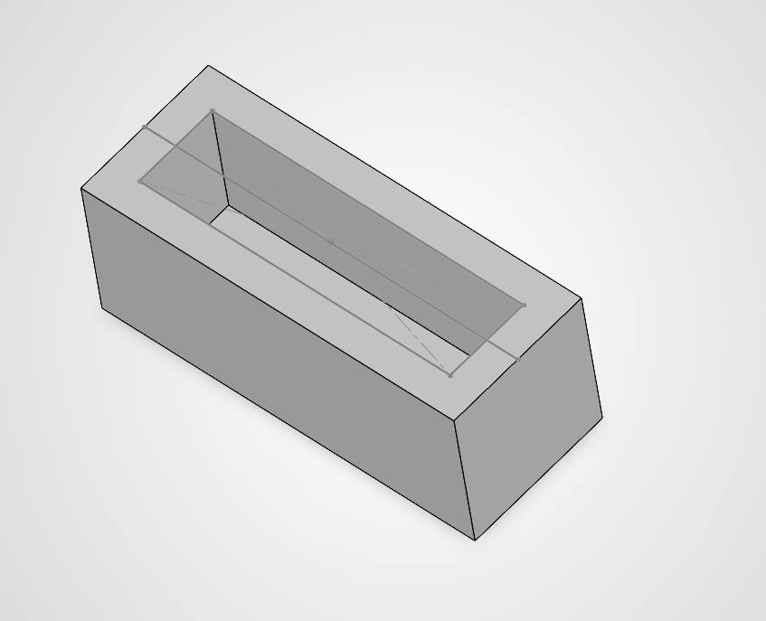

After generating this box I then made a sketch of a rectangle at the middle of the box on the top. I gave this rectangle the dimensions of my minimum needed cavity dimensions, and extruded it down so that I had the needed space to hold the gears. 

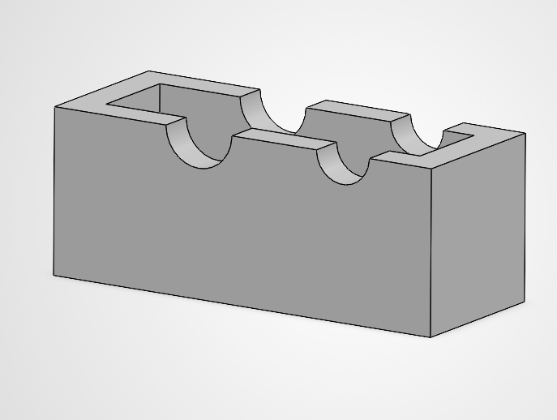

After making this hollow holding space, I needed to make the divots for the gears to slot into. I made these holes by putting a circle sketch at the top half of the box and extrude cutting it all the way through. The diameters of these sketches were equal to the bearings outer diameters because that's where each would sit. To place the holes, I used the thickness of the left side + the outer radius of the gear + a desired space between the gear and wall of 0.020in. The pinion shaft hole was place by basing it where the gear shaft hole was. I determined this value by adding the gear and pinions pitch radius. This was the final step for the general shape of my housing bottom half.

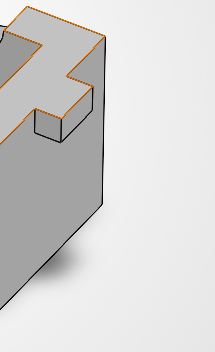

The next step was to make the slots for which the snaps of the top half would hook into place. I did this by extruding a very small box on the side of the housing and cutting a hole into it so that it was hollow.

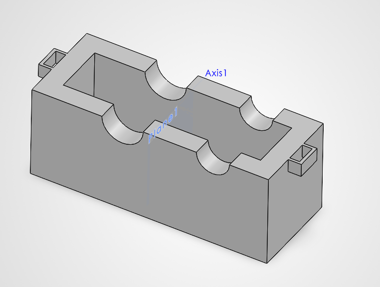

To ensure that this slot feature was on either side, I utilized a reference plane to mirror the geometry to the other side of the housing. This was the final design for the bottom half of my gearbox housing. 

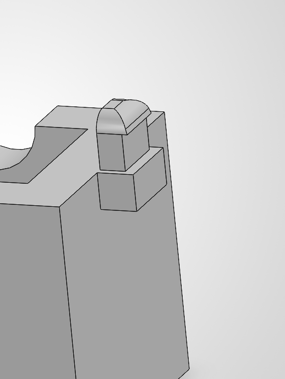

Rather than starting from scratch on the top half, I made a copy of the bottom half and only changed the slots into hooks. I did this by extruding that almost had the same geometry as the hollow section of the slots, except it was slightly thinner to allow the hook to actually grab the edge of the slot. After doing this I did the same mirroring strategy to ensure there was hooks on either side.
#### Assembly for gearbox
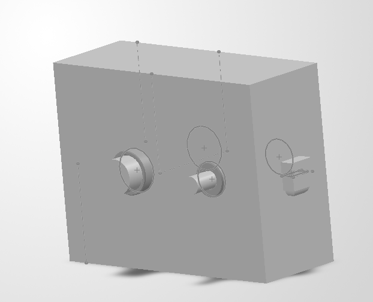

After making All my CAD design separately, I was tasked with putting them all together in a cohesive assembly. I had previous experience assembling basic designs from old classes; however, I had never worked with gears in a CAD software. In order to figure out how I could get the gears to rotate properly I used the following video:

How to Mate Gears in SolidWorks: https://www.youtube.com/watch?v=ErnvSU8775g

Once I figured out how to mate the two gears the rest was just like normal from there. Using various coincident and concentric mates I came up with the final assembly in the image above. The image below shows an exploded view of each separate part and how they mesh together. 

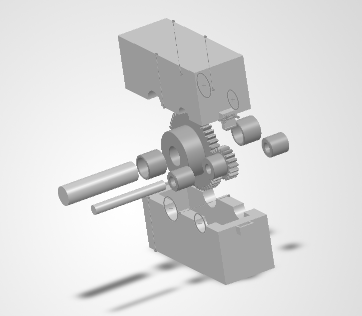

### Drawings for Each Part
The final part for my assignment was to make engineering drawings for all parts made except for the provided gears. All the drawing are labeled below:

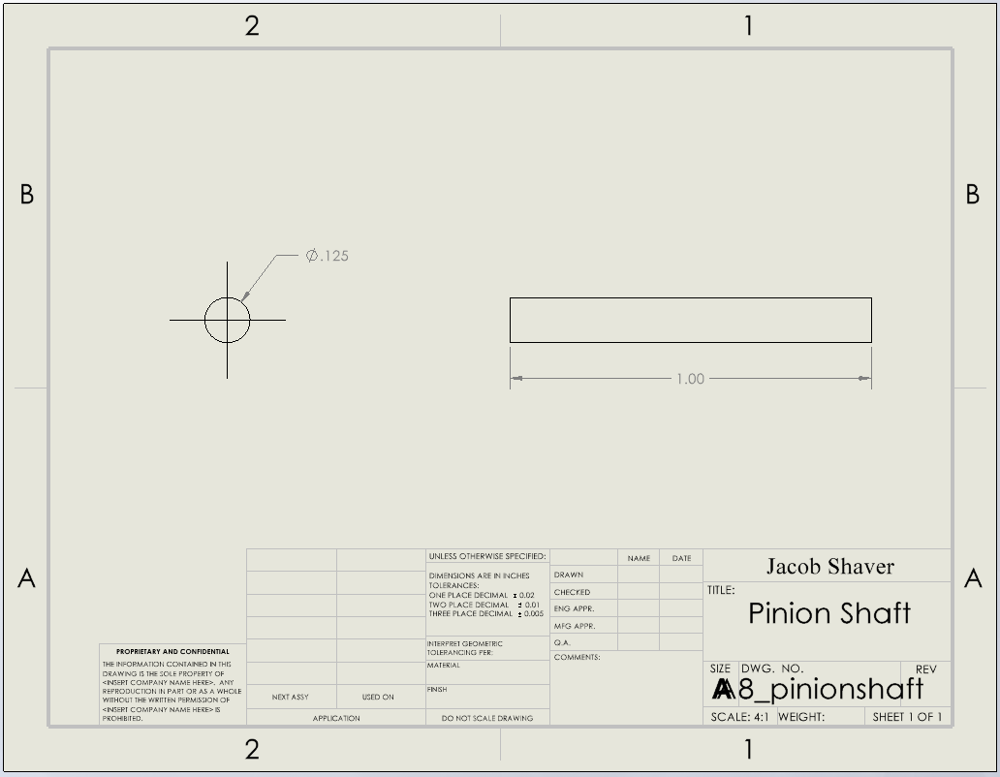
(Pinion Shaft)

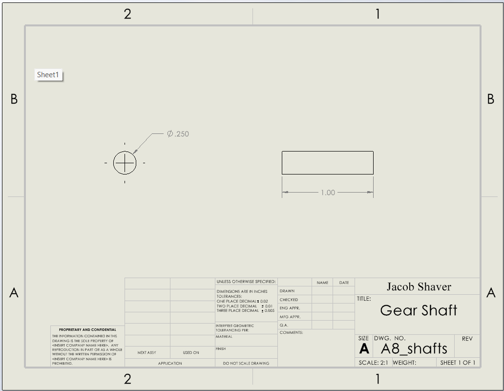
(Gear Shaft)

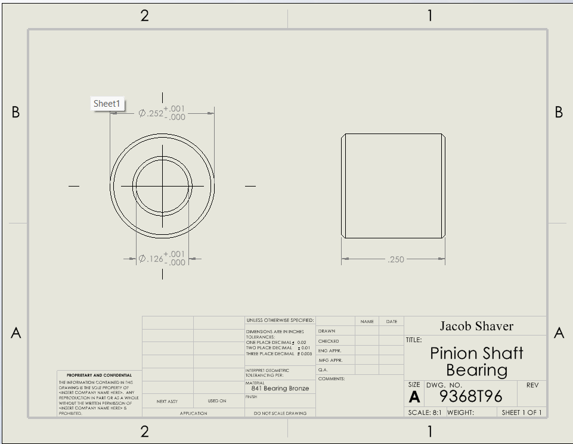
(Pinion Bearing)

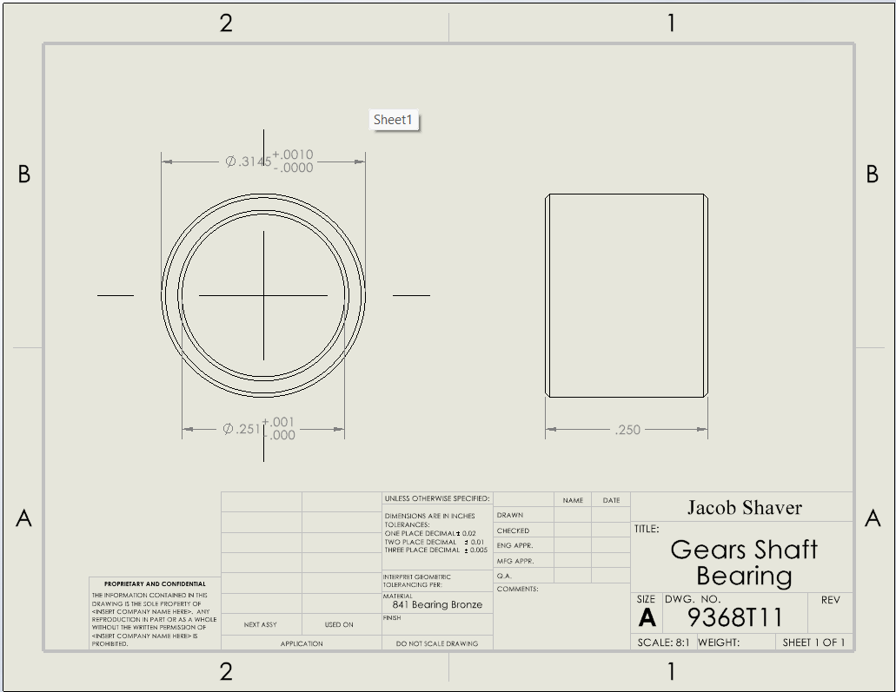
(Gear Bearing)

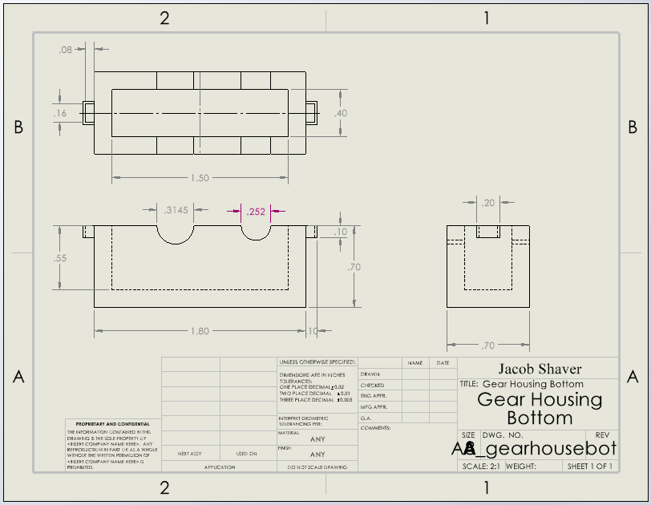
(Bottom of Gear Housing)

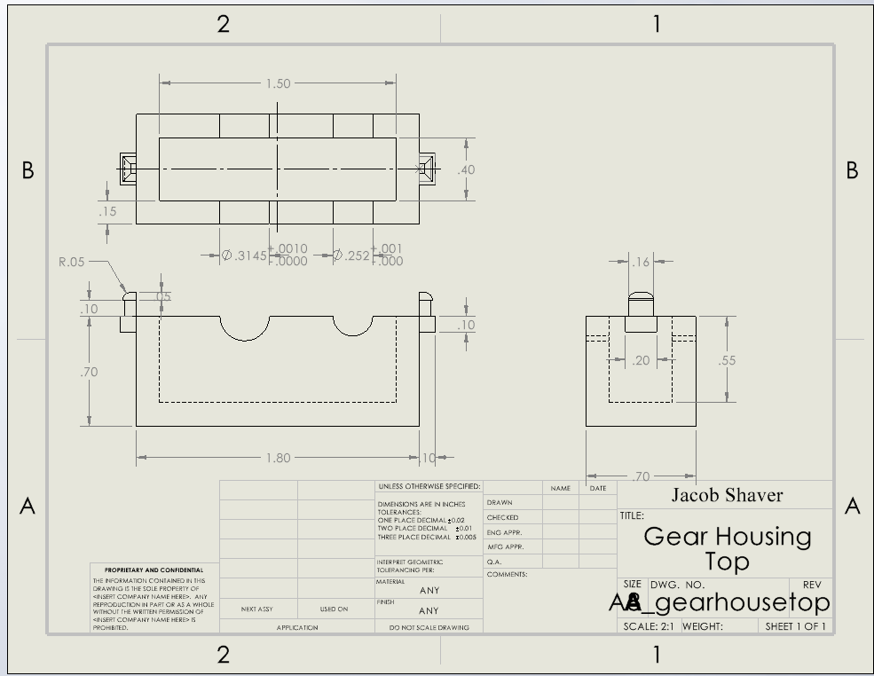
(Top of Gear housing)

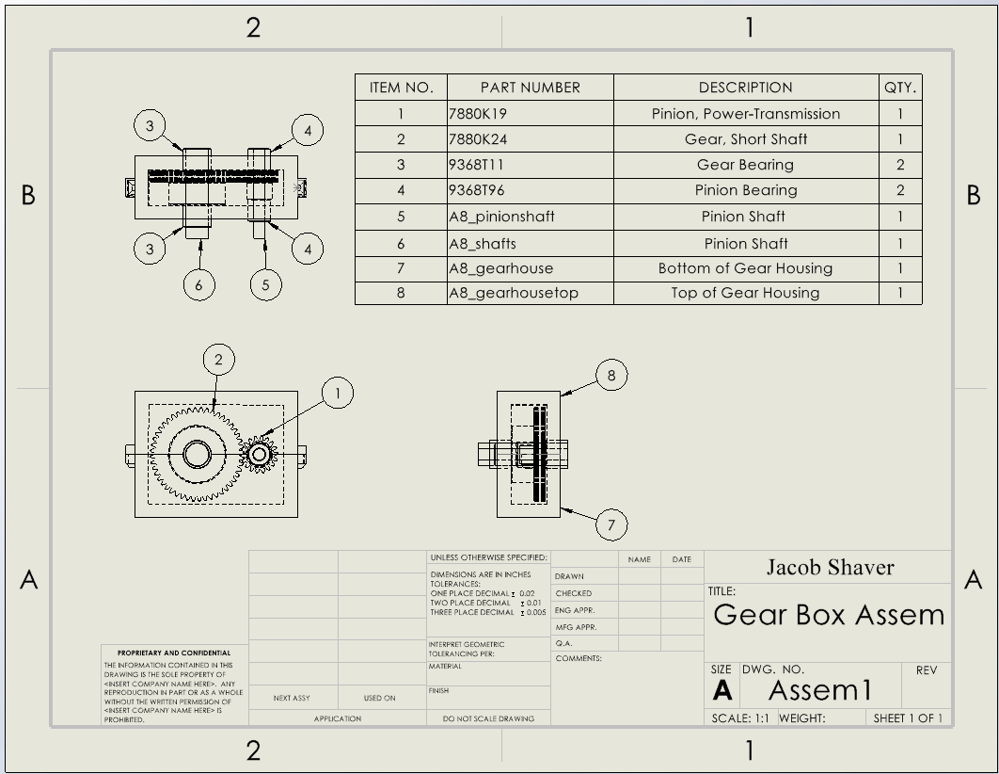
(Final Assembly)

### Lessons Learned

This assignment was definitely a challenge for me, which made way for a plenty of new lessons to learn. The first major lesson I can think of is using SolidWorks to make an assembly, because it was new territory in relation to doing that with this software at all and it was my first time assembling gears. All of the mates were tricky at the start but got way easier for me as the assignment went on. The next lesson that I learned was different ways to fix geometry's together. On this assignment I decided to use a snap fit because it was something I had never designed before. This assignment also showed me how calculations of ideal values can be pretty far off what you can get from suppliers, as my calculated thickness was leagues lower than I could find on the McMastery website. This assignment probably took me roughly 12 hours to complete in totality, because I messed up in the assembly prices a bit in the start causing me to restart it a few times.

### Zip Files for All Parts/Drawings/Assembly
[A8 Part Files](A8partfiles.zip)

[A8 Drawing Files](A8drawfiles.zip)

[A8 Assembly files](Assemfiles.zip)
