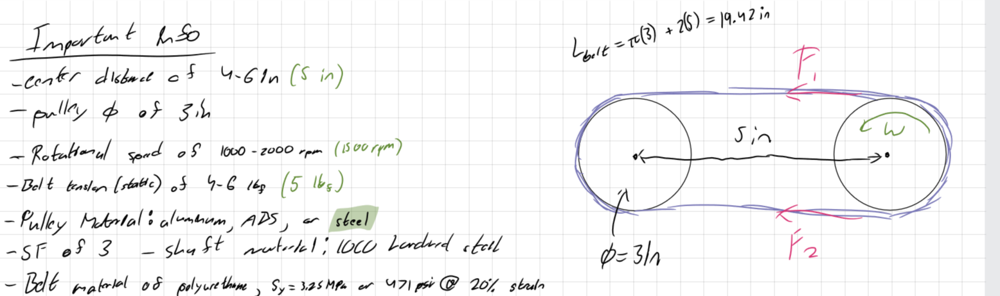
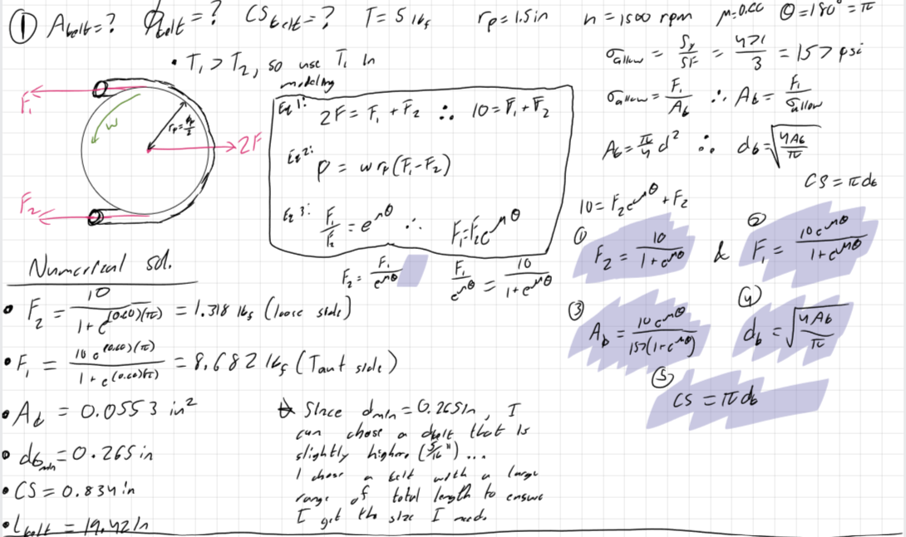
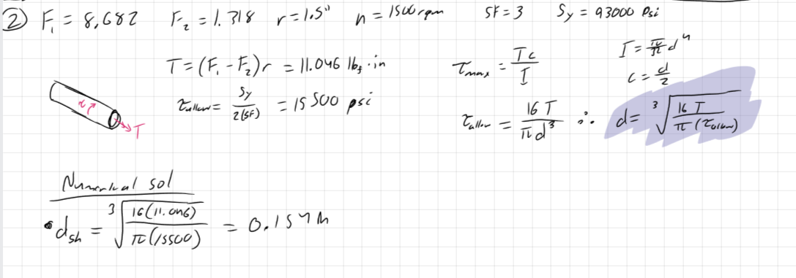
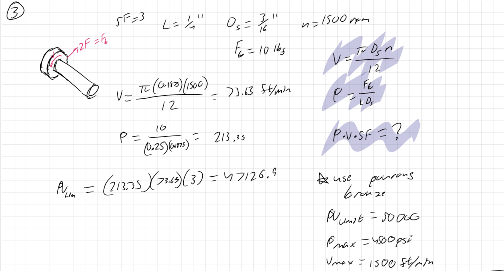
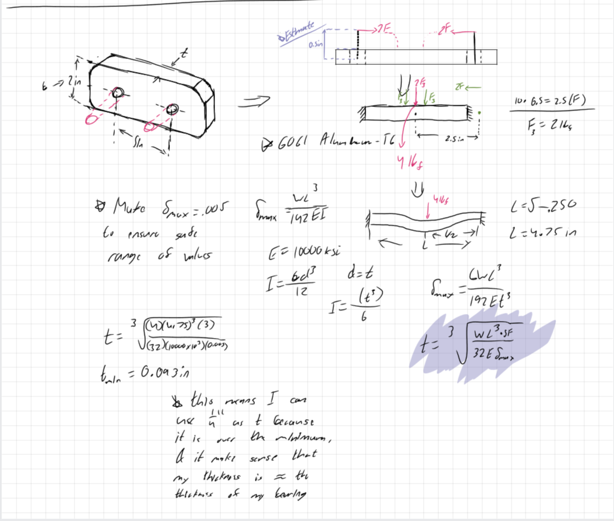

# A9 – Pulleys

## Objective
This assignment tasked me with designing a pulley system under a certain situation. We need to use a combination of different concepts used throughout this course. which include but are not limited to friction, static analysis, and dynamic analysis.

## Analyze
Before I started my analysis I needed to make sure that the pulley system would be made with the following parameters in mind:
- The axis' need a center distance of 4-6 inches
- Both pulleys must have a diameter of 3 inches
- The operating speed must be 1000-2000rpm
- The belt tension must be 4-6 lbf
- The pulley material may be aluminum, ABS, or steel
- The design must satisfy a minimum safety factor of 3

## Decide
The image below shows the different values and materials I decided to use for the assignment. I essentially chose to throw all my values right in the middle of the ranges because that's what felt right. I also determined some important things before starting like the total length the belt needed to be to go around both pulleys with my determined center distance. 

## Communicate
### Belt Design
After determining all the different aspects of the assignment I began by designing the minimum diameter of the belt. One important value that I determined from class slides was that the coefficient of friction for rubber to steel connection was 0.60. To get to the size of the belt I needed to find F1, F2, and cross-sectional area in that order. After finding area I could determine the minimal cross-sectional diameter and the circumference. This entire process is in the image below. 

After finding all this information I needed to find an actual belt on McMaster. I knew that my actual diameter wouldn't be a standardized sizing so I went with the smallest possible match that still was greater than my theoretical minimum. I decided to use a belt diameter of 5/16", and the listing I found ranged from a length of 10"-1200", and it increased in increments of 1/4". This was perfect because I could get stock that met my minimum diameter requirements, and I could order a size that was as close as possible to my desired length. 

Belt link: https://www.mcmaster.com/9462T58/

### Shaft Desin
After designing the belt I needed to design the shaft by finding the minimum dimensions when torque is applied. I used Matweb to determine the yield strength for 1060 hardened steel, which ended up being 93000 psi. To design the geometry I used the maximum allowed stress under the torque applied. The image below shows my entire work process. 

I decided to base the actual size of my shaft to be based on my bearing, which is in the next section. This is because my bearing will be some standard size, and its much easier to match some shaft stock size to the bearing rather than manufacturing my own shaft and bearing. The main consideration is to make sure the stock shaft I choose is still larger than the minimum that I determined. 

### Journal Bearing Design
After designing my shaft I then began to work on the bearing size, and material confirmation. To do this I needed to find Pressure, Velocity, and PV rating. The work to do that is in the below image. 

After finding those values I cross referenced them to the same chart I used in assignment 8, and I determined that my material should be a porous bronze. I came to choose this material because it seemed to be the most accessible, and it had the most size choices while still fitting the calculated PV limit. I then chose the appropriate bearing size using McMaster, making sure that I used 841 bronze. The inner diameter I settled on was 3/16" which I also chose to make the shaft diameter, so they would press fit together. This value was still higher than the minimum shaft diameter I determined earlier so I am assuming that all sizes will meet my requirements. 

Journal Bearing Link: https://www.mcmaster.com/6391K122/

### Pulley Frame Design
The last part of this assignment instructed me to use engineering analysis to design a pulley frame. I decided to make my pulley frame out of aluminum because I figured that the frame didn't need to be as stiff as a part like the shaft. My design is essentially a box with a height of 2 inches, a width that can hold both holes for the bearings, and a thickness that's equal to the bearing thickness. I made the height 2 inches because it would be very easy to line up the bearing holes right in the middle of the plate. The way that I designed the plate made it so that width could be any value, as long as it properly fit both holes. This could leave leeway for changes if the center distance between the holes ever changed. The size of the holes are to be close to the size of the bearings outer diameter. The thickness is to be the total length of the bearings. To ensure that my design was within my safety factor of three, I decided to complete a deflection analysis of the frame. The following work below shows that my minimum thickness is well below the 1/4" that I decided on.

### Lessons Learned
The biggest lesson I learned is how all of the previous analysis that I worked on individually can all come together in one full design. This assignment had me design multiple different parts that each needed a very distinct analysis. It was fun to do this and see it all come together to make a cohherent pulley system at the end. 

Another lesson I learned was how standard manufacturing can dictate sizes of parts. While I was going through it was clear that the found values weren't realistic because it would cost so much more to make those custom parts for this one pulley. However, if you cross reference your found values with standard ones then you can chose very nice and mass produced parts that still meet your requirements. 

